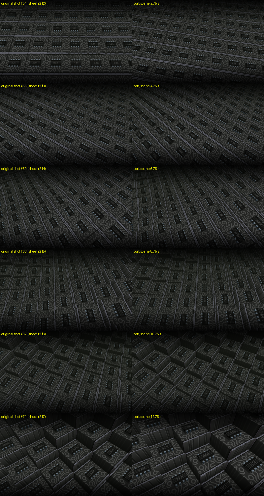

# insert-chipcity

The "chip city" scene of **Insert No Coins** (Razor 1911, Win32 64k intro, 2010; code rez,
logo ilkke, music dubmood), ported to C++17 / SDL3 / OpenGL 1.x. The camera flies over a 16x16
grid of circuit-board blocks, each with a DIL chip on top, while the blocks rise and fall in a
wave. This is row 2 frames 2-7 of `rea/rzr-insert-analisis/sheet.png`; the port covers the
whole scene, music orders 4-7 (15.36 s): the white flash and zoom-in at the start, then the
camera swing and white-out at order 7 row 0x36.

Visuals only: the intro's XM player is not ported.



## Build and run

```bash
cmake -S . -B build && cmake --build build -j
./build/insert-chipcity [--original] [--scale N]   # Space pause, R restart, F fullscreen, Esc quit
./build/insert-chipcity --dump DIR --fps 50 [--original]  # one loop of 800x500 PPMs, hidden window
ctest --test-dir build                          # ~2 s
```

The scene renders at the original 800x500 into a framebuffer object, scaled to the window.

By default the camera flight loops seamlessly (not in the original). The block wave, the camera
bob and the fov wobble all repeat after a phase of 16π, i.e. 28.8 s. The spin is slowed from
8 to 360/(16π) degrees per radian of phase, 12.5°/s, so it makes exactly one turn in that time.
The start flash and zoom and the closing swing are left out. `--original` plays the scene as in
the intro (15.36 s with flash, zoom and swing, then it restarts); that is the path the tests
check.

## How exact

The original is plain fixed-function GL 1.x (immediate mode, display lists, one 256x256
texture, linear fog), so "exact" here means the GL call stream: the port makes **the same
calls with the same float bits** as the original. The test checks this against a GL trace of
the original run under Wine:

- display lists 1, 3, 4, 5: call for call (`tests/data/lists.txt`);
- the texture atlas: CRC of the traced upload;
- all **3005 traced frames** of the scene: CRC32 of each frame's whole call stream (2075-2084
  calls) in apitrace's text format at round-trip precision.

The trace has no frame times, but they are recoverable exactly. Every input is a difference of
the phase variable b = 100·t·π/180. The scene starts one float step below b = 32, and later
phases are floats in [32, 64), i.e. multiples of 2^-18. The test finds each frame's phase
by search and then compares the whole frame. Under Wine with llvmpipe the original ran at about 196 fps here (3005 frames in 15.34 s).

Pixels depend on the GL driver, so they are not compared; `doc/compare.png` is a visual check
against screenshots of the original.

### What it takes to match

- **x87 arithmetic.** The intro is MSVC6 code with float globals and x87 maths at control word
  0x27F (53-bit precision). Its `cos`/`sin` are bare `fcos`/`fsin`, and their 64-bit-mantissa
  result feeds the next operation. `src/x87.h` computes in `long double` under 0x27F and
  calls `fcos`/`fsin` with inline asm. So the port needs an x86 CPU.
- **gluPerspective.** The projection matrix comes from Wine's glu32, which uses Wine
  msvcrt's musl `sin`/`cos`; `glu_perspective` reproduces it, including the early return when
  sin(fovy/2) = 0. On the first frame of the scene the zoom pulse gives fovy = 0, so that frame
  keeps an identity projection (it is drawn under the full white flash). On real Windows the
  glu32 matrix could differ in its last bits.
- **Event timing.** In the original, the order 4 and order 7 row 0x36 events land on whichever
  frame first sees the new music row. The port triggers them at the exact row times
  (speed 3, 125 BPM: 0.06 s per row; the XM starts at t = 3 s). The effects that end once an
  angle passes π/2 (flash, zoom) still use their last frame's value, like the original.
  At very low frame rates that last frame overshoots: `--dump --fps 0.5` shows a white frame.

## Files

| File | What |
|---|---|
| `src/chipcity.cpp` | the scene: translation of the chip-city path of the frame function `FUN_00424858` (addresses in comments) |
| `src/x87.h` | x87 precision control and `fcos`/`fsin` |
| `src/gl_sink.h` | the GL calls as an interface; `gl_real.cpp` executes them, `gl_record.cpp` prints them like `apitrace dump` |
| `src/lists.inc` | display lists 1, 3, 4, 5, generated by `tools/make_lists.py` from the trace |
| `data/atlas.png` | the texture atlas, as uploaded by the original (generated at run time by the intro) |
| `tests/data/frames.txt`, `lists.txt` | reference from the trace (`tools/make_reference.py`) |
| `doc/compare.png` | original screenshots (sheet row 2 frames 2-7) next to the port |

Reverse-engineering notes, the Wine/apitrace tracing setup and the unpacked image are in
`~/proy/rea/rzr-insert-analisis` (README, "Chip city port" section).
